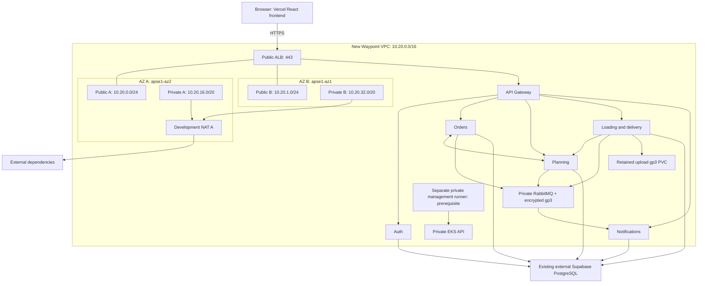

> Phase D updates and current release gates: [PHASE-D-REVIEW.md](PHASE-D-REVIEW.md).

Common runner tools, Supabase CA, and RabbitMQ can now be managed with
[Ansible](ansible/README.md). Use its `common` playbook for setup and `preflight`
for verified database connectivity; application releases remain separately gated.

# Waypoint AWS configuration review — Phase C

Status: configuration preparation only. No cloud or Kubernetes changes were executed.
Do not deploy this application until the blockers in SECURITY-REVIEW.md are resolved.
The configuration preserves all existing EC2, EBS, VPC and database resources outside
Terraform management. No import blocks or existing-resource mutation are included.

## Layout and ownership

- `terraform/bootstrap`: creates a new versioned, encrypted, private state bucket,
  initially using local state. This bucket does NOT exist merely because these files exist.
- `terraform/infrastructure`: new VPC, routes, one development NAT, private EKS,
  managed nodes, ECR, cluster logs, IAM, CSI, runner/ALB security groups.
- `terraform/addons`: separate state for the pinned ALB controller Helm release and IAM.
- `kubernetes`: administrator-owned application/RabbitMQ/configuration templates.
- `../Jenkinsfile`: trusted CI only, test/build/scan, publication approval, deployment approval.
- `scripts`: local validation and future CI scripts. Do not run `deploy.sh` during Phase C.

State keys: `waypoint/dev/bootstrap/terraform.tfstate`,
`waypoint/dev/infrastructure/terraform.tfstate`,
`waypoint/dev/cluster-addons/terraform.tfstate`.

## Network design

The 2026-10-13 read-only Singapore inventory returned `10.0.0.0/16` and
`172.31.0.0/16`; neither overlaps `10.20.0.0/16`. Repository networking documentation
contained no additional connected network CIDRs. Earlier read-only checks returned no
peering, transit VPC attachments or VPN gateways for the custom VPC. Other regions,
on-premises, partner networks, IPAM reservations and future connectivity remain UNKNOWN.
Populate `known_network_cidrs` before plan review; a Terraform precondition rejects overlap
with every declared range. This is not an account-wide proof of non-overlap.

| Purpose | CIDR | AZ ID / observed account AZ name |
|---|---|---|
| Public A | 10.20.0.0/24 | apse1-az2 / ap-southeast-1a |
| Public B | 10.20.1.0/24 | apse1-az1 / ap-southeast-1b |
| Private A | 10.20.16.0/20 | apse1-az2 / ap-southeast-1a |
| Private B | 10.20.32.0/20 | apse1-az1 / ap-southeast-1b |

Public subnets route to IGW. Private subnets route to NAT A in development;
`nat_per_az=true` gives each private subnet a NAT in its own AZ. A free S3 gateway
endpoint reduces ECR layer download traffic through NAT. It is not an upload bucket.
Private workers have encrypted 30-GiB gp3 roots and IMDSv2 with hop limit 1.
Only ALB 443 is internet-facing; there is no public SSH/RDP, RabbitMQ management Service,
public Kubernetes API, frontend pod or second reverse proxy. EKS controls its node/cluster
security group; Kubernetes NetworkPolicies restrict application paths using VPC CNI enforcement.
VPC CIDR changes require corresponding NetworkPolicy changes.



All six applications run on private nodes spanning A/B. Diagram shows logical services,
not a promise of per-service high availability; development replicas are one.

## Safe local validation

From repository root:

```bash
terraform fmt -check -recursive infrastructure/terraform
terraform -chdir=infrastructure/terraform/bootstrap init -backend=false -input=false
terraform -chdir=infrastructure/terraform/bootstrap validate
terraform -chdir=infrastructure/terraform/infrastructure init -backend=false -input=false
terraform -chdir=infrastructure/terraform/infrastructure validate
terraform -chdir=infrastructure/terraform/addons init -backend=false -input=false
terraform -chdir=infrastructure/terraform/addons validate
python3 infrastructure/scripts/validate.py
bash -n infrastructure/scripts/ci-test.sh infrastructure/scripts/loading-integration.sh infrastructure/scripts/images.sh infrastructure/scripts/deploy.sh
```

Provider versions and dependency lockfiles must be reviewed and committed. Provider
initialization downloads plugins; it does not provision resources with `-backend=false`.
YAML parsing alone does not prove Kubernetes compatibility. Once kubectl/kubeconform
are installed, render using `kubectl kustomize infrastructure/kubernetes` and validate
against the chosen Kubernetes schema. Server dry-run needs an existing reachable cluster
and admission controllers and is deferred.

## Future read-only Terraform plan review

Do not run provisioning commands in this phase. These commands are for future review;
run them with an approved read-only AWS identity. Do not use `-refresh=false` to conceal drift.

Bootstrap review (no bucket assumed):

```bash
export AWS_REGION=ap-southeast-1
aws sts get-caller-identity --region "$AWS_REGION"
test ! -e infrastructure/terraform/bootstrap/terraform.tfvars
cp -n infrastructure/terraform/bootstrap/terraform.tfvars.example infrastructure/terraform/bootstrap/terraform.tfvars
# Edit owner and a new globally unique bucket name; no secrets.
terraform -chdir=infrastructure/terraform/bootstrap init -backend=false -input=false
terraform -chdir=infrastructure/terraform/bootstrap validate
terraform -chdir=infrastructure/terraform/bootstrap plan -input=false -lock=false
```

The bootstrap remains local until separately approved provisioning creates and verifies
the bucket. A later, separately approved state migration adds an S3 backend block to
bootstrap and uses its `backend.hcl.example`. Migration writes state to S3 and is NOT a
read-only plan operation. Secure the local bootstrap state until migration succeeds.
S3 native `.tflock` locking needs GetObject/PutObject/DeleteObject on the state key's lock
object, GetObject/PutObject on the state key, and ListBucket restricted to the state prefix.
Grant only the relevant state prefix to each automation role. Enable protected recovery
access to bucket versions. Never store app secrets through Terraform.

Infrastructure review before backend creation: use a temporary copy without `backend.tf`,
so Terraform does not attempt to access a nonexistent bucket:

```bash
review_dir=$(mktemp -d /tmp/waypoint-plan-XXXXXX)
cp infrastructure/terraform/infrastructure/*.tf "$review_dir/"
cp infrastructure/terraform/infrastructure/.terraform.lock.hcl "$review_dir/"
rm "$review_dir/backend.tf"
cp infrastructure/terraform/infrastructure/terraform.tfvars.example "$review_dir/terraform.tfvars"
# Edit the copied owner/role inputs, known CIDRs and compatible add-on pins.
terraform -chdir="$review_dir" init -backend=false -input=false
terraform -chdir="$review_dir" validate
terraform -chdir="$review_dir" plan -input=false -lock=false
```

This is a proposed-new-resources plan, NOT a plan against remote production state. No
plan file is saved. Review every ARN/name, SG rule, storage lifecycle and cost first.
After a verified backend exists, copy its example to ignored `backend.hcl`, fill the
actual bucket, and initialize the infrastructure directory with
`terraform init -backend-config=backend.hcl -input=false`. For strictly read-only review
use `terraform plan -input=false -lock=false` only while all state writers are paused;
normal future mutating workflows must keep locking enabled. Backend init can read state;
never pass `-migrate-state` during read-only review.

Before planning add-ons: cluster must exist, the runner must reach its private API,
admin role must be mapped, Pod Identity agent must be healthy, and `vpc_id` must identify
the NEW VPC. Then initialize its separate backend and run `terraform validate` and
`terraform plan -input=false -lock=false` with writers paused. Do not plan it against
invented endpoints or the existing unrelated VPC.

Candidate selected from the Singapore read-only API: EKS 1.35 standard support;
add-on pins in the example were returned compatible with 1.35. Runtime/controller
qualification remains pending; see PHASE-D-REVIEW.md. Recheck before approval:

```bash
aws eks describe-cluster-versions --region ap-southeast-1 --output table
aws eks describe-addon-versions --region ap-southeast-1 --kubernetes-version 1.35 --addon-name vpc-cni
```

Repeat the latter for all five add-ons. The pinned ALB controller policy is vendored from
https://raw.githubusercontent.com/kubernetes-sigs/aws-load-balancer-controller/v2.14.1/docs/install/iam_policy.json.
Chart 1.14.0 explicitly uses controller v2.14.1; review Kubernetes-version compatibility
before provisioning. Pin image digests following successful builds/scans.

## Future application configuration

An administrator must review and provision the namespace, storage, RabbitMQ, RBAC,
network policies and six initial Deployments before Jenkins can update images. Jenkins
has no permission to create these resources or read Secrets. No such provisioning was
performed here. Replace all `REPLACE_*` values and `api.example.invalid` in a private
rendered copy; retain templates as examples until values exist. Use a real ACM certificate
in Singapore with DNS validation and an API hostname you control; neither is invented here.

Create separate Secrets named `<service>-secrets`, plus `rabbitmq-secrets`, in
`waypoint-dev` through a reviewed secret-management workflow. Do not commit rendered Secrets.
Prefer per-service database identities, rotate all known development JWT keys, and align
issuer/audience. See SERVICE-INVENTORY.md for exact keys. These manifests consume Kubernetes
Secrets only; automatic Secrets Manager synchronization is NOT installed. Use restricted
RBAC and the managed EKS encryption facilities; choose a Secrets Manager integration in a
separate reviewed change if required.

On Vercel set `VITE_API_BASE_URL=https://<verified-api-domain>/api`, then rebuild/redeploy.
`VITE_WS_URL` exists in the example but no frontend consumer was found; setting it alone
does not implement WebSockets. Validate JWT login/refresh, role boundaries, preflight and
browser WebSockets after the security fixes. Never put service-role keys or database
credentials in Vite variables. Frontend deployment on Vercel is outside this pipeline.

## Jenkins prerequisites and behavior

Use a separate private management host/runner, never an application EKS node. Its lifecycle
and existing role are supplied externally; this phase prepares its SG and a narrowly scoped
delivery role but does not create a Jenkins VM. The selected topology places the host in a private subnet of the new VPC,
with the prepared runner SG attached, and use SSM administration with no inbound
ports. HTTPS egress supports AWS, GitHub and registries. Supply a separate instance role
with SSM permissions and permission to assume only the output delivery role. The delivery
role has ECR access to six repositories and DescribeCluster; Kubernetes Role grants only
updates to six named Deployments plus rollout reads. No infrastructure provisioning powers.

Runner tools: Docker, Java 21/Maven, .NET 8 SDK, supported Go, Node/npm compatible with the
frontend lockfile, Python/PyYAML, AWS CLI v2, kubectl compatible with the selected EKS version, Trivy. Jenkins
plugins: Pipeline, Git, JUnit, Pipeline: AWS Steps (`withAWS`). Configure group
`waypoint-release-approvers` in your identity realm and prevent untrusted PRs from using
this agent/role. Docker socket access is privileged; isolate this dedicated runner.

All services are rebuilt because protobuf/shared changes affect multiple services. Tests
run first; Go formatting/vet and dependency/image scans fail the build on findings.
Planning Testcontainers tests may not silently skip; loading integration tests run against
unique disposable local fixtures, never Supabase. Auth's existing integration project is a
placeholder and does not constitute integration coverage. SHA tags are immutable; rerunning
a successful publication for the same SHA will fail safely rather than overwrite an image.

`REQUEST_RELEASE=false` is the default. Publication and deployment each require approval;
short-lived AWS credentials are acquired separately after each gate. Application deployment
only changes image references and waits for rollouts. Smoke checks cover unauthorized API
access and CORS, not full business behavior or data durability. The pipeline itself needs
Jenkins validation before enablement; do not interpret shell/YAML checks as Jenkins execution.

```mermaid
flowchart LR
  git["Trusted Git checkout"] --> tests["Format, unit and isolated integration tests"]
  tests --> scan["Dependency scan, six image builds and scans"]
  scan --> publish["Explicit publication approval"]
  publish --> ecr["Assume delivery role and push SHA images"]
  ecr --> approve["Explicit development deployment approval"]
  approve --> rollout["Patch six image references and wait"]
  rollout --> smoke["Unauthorized API and CORS smoke checks"]
  smoke --> report["Jenkins status and test reports"]
```



## Storage, rollback and cleanup

RabbitMQ and local uploads each request a 10-GiB encrypted gp3 PVC. WaitForFirstConsumer
aligns binding with the scheduled AZ; Retain prevents automatic disk deletion when a PVC
is removed. Single RabbitMQ replica and single upload writer are DEVELOPMENT constraints,
not multi-AZ data availability. Upload deployment uses Recreate to avoid RWO multi-attach.
Do not scale it beyond one until shared/object storage works. No EBS for other APIs.
No application S3 bucket: code has local/Supabase storage, no S3 adapter.

Before data-bearing deployment, define snapshot/backup retention and test restore for both
volumes. Retain is NOT backup. Coordinate RabbitMQ data-consistent backups and retention;
PVC deletion can orphan billable retained volumes. Supabase backups and migration recovery
are managed separately. Image rollback cannot undo database mutations.

Record all six previous image SHAs before deployment. On failure, inspect rollout events
and logs with an operator identity, then request rollback approval and patch those exact
known-good SHA images through the same gated process. Do not auto-rollback schema changes.
An approved future cleanup should remove Ingress first and confirm ALB/target cleanup,
back up persistent data, then remove workloads/add-ons before the cluster/network. Never
include the old VPC, EC2, EBS or external Supabase in cleanup. State bucket is protected by
prevent_destroy and retained versions; do not bypass these protections casually.

## Future image commands (not executed in Phase C)

After tests pass, set a verified registry and full commit SHA. Building/scanning is local;
the push block requires explicit publication authorization:

```bash
export ECR_REGISTRY='<account>.dkr.ecr.ap-southeast-1.amazonaws.com'
export IMAGE_TAG="$(git rev-parse HEAD)"
bash infrastructure/scripts/images.sh build
# Only after publication approval and assuming the delivery role:
aws ecr get-login-password --region ap-southeast-1 | docker login --username AWS --password-stdin "$ECR_REGISTRY"
bash infrastructure/scripts/images.sh push
```

Every build command uses `-t "$ECR_REGISTRY/waypoint-dev/<service>:$IMAGE_TAG"` directly,
so a separate retag operation is unnecessary. Java builds use the repository root for
shared proto files; Go and .NET use their own service contexts. No `latest` deployment tags.
A failed immutable-tag push must be investigated; do not disable immutability to force it.

EBS CSI uses `AmazonEBSCSIDriverEKSClusterScopedPolicy` with Pod Identity, so its resource
permissions are scoped to this cluster rather than existing unrelated disks. The pinned
EKS add-on is newer than driver 1.58 and supplies the cluster-ID flag needed for automatic
cluster tags. See https://docs.aws.amazon.com/eks/latest/best-practices/identity-and-access-management.html.
No pre-existing volumes are adopted or retagged. Application log shipping and snapshot
controller/backup automation are not installed in this draft; cluster control-plane logs
are configured with 14-day retention.
